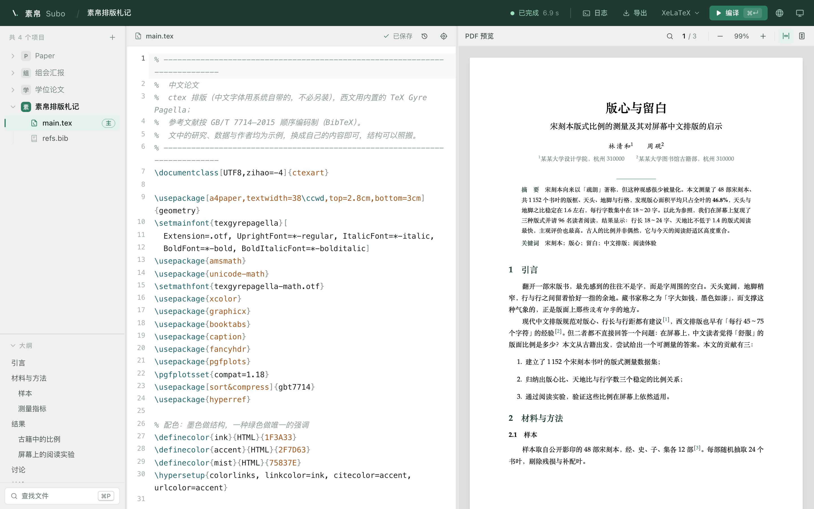
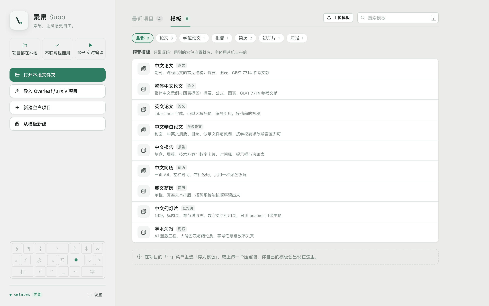
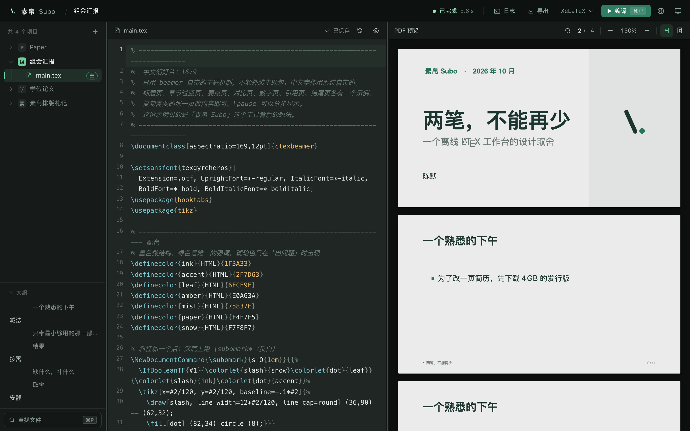

<div align="center">

<picture>
  <source media="(prefers-color-scheme: dark)" srcset="docs/brand/subo-mark-inverse.svg">
  
</picture>

# Subo

**A LaTeX editor that works out of the box.**

Install it, then write, compile and preview. Your documents stay on your own computer, and projects whose
dependencies are already installed compile offline.

[Website & download](https://www.subo.ink/en/) · [Why Subo](#why-subo) · [Features](#features) · [Install](#install) · [Development](#development) · [Docs](#docs)

[简体中文](README.md) · English

</div>

<picture>
  <source media="(prefers-color-scheme: dark)" srcset="docs/images/article-dark.png">
  
</picture>

<p align="center"><sub>Built-in template "Chinese paper": files and outline, source, and a live PDF.</sub></p>

## Why Subo

People who write LaTeX usually go back and forth between two options:

- **Online editors** are ready instantly, but your manuscript lives on someone else's server. Compiles queue
  or time out before deadlines, free quotas run out, nothing works offline, and unpublished papers or
  internal reports aren't always fit to upload.
- **Local distributions** keep your data yours, but cost an afternoon: download several GB, pick an editor,
  set up a PDF viewer and forward/inverse search, hunt for CJK fonts — all before editing a one-page CV.

And once you're writing, errors say `File 'xxx.sty' not found` without telling you which package to install,
where from, or whether it will mess up your setup.

**Subo merges the two**: open it and write, like an online editor; own everything, like a local setup.

|                                |                                                                                   |
| ------------------------------ | --------------------------------------------------------------------------------- |
| **Compiles right away**        | The installer ships a trimmed TeX Live. Chinese works out of the box; no separate TeX install. |
| **Fetches what's missing**     | Missing packages can be installed on demand. Offline, they're queued and installed once you're back online. |
| **Files are just files**       | A project is an ordinary folder: use git, edit it in other tools — Subo notices.  |
| **Local first**                | No accounts, no cloud projects. With the engines and packages already on your machine, it works offline. |

Installing missing packages contacts the download mirror you configure; optional AI features send requests to
the service you configure. The desktop app checks for updates by default (can be turned off); automatic
download is off by default.

## Features

**Write**

- Completion for LaTeX commands and environments — `\begin{fig` expands to a full skeleton; `\ref` / `\cite`
  collect every label and `.bib` entry in the project
- An outline that follows `\input` / `\include` across all chapters; click to jump
- Find and replace, comment, one-click formatting, quick open by file name — with keyboard shortcuts

**Compile**

- ⌘↵ to compile with live status. XeLaTeX and pdfLaTeX are bundled; LuaLaTeX, pTeX and others install on demand.
  The engine is chosen per project automatically
- An issues panel turns errors, warnings and overfull boxes from the log into a list that jumps to the source line
- Compiles have time and memory limits, so a runaway document can't bring down your machine

**Preview**

- The PDF only renders pages near the viewport, so a several-hundred-page thesis opens instantly; recompiling
  doesn't flash or lose your place
- Two-way SyncTeX: from source to PDF, or double-click the PDF to return to the source
- Light, dark or system appearance; UI in Simplified Chinese, Traditional Chinese, English, Japanese and Korean

**Peace of mind**

- Local history: a snapshot every few minutes; compare and restore in one click, never written into your project
- If another program changes the open file, Subo reloads it; when both sides changed, you choose and the other
  copy goes to history
- **Case snapshots**: pack the extra packages a project actually uses into one file and import it on an offline machine

**Getting started**

- Built-in templates: papers in several languages, thesis, report, CV, slides, academic poster
- Import zips exported from online editors, GitHub archives and arXiv source bundles, or open an existing local
  folder and edit it in place

**Optional: AI assistance**

- ⌘K rewrites the selection; "Fix" next to an error. Results appear as an inline diff — Tab to accept, Esc to reject
- Bring your own API key for any OpenAI-compatible service, or a local model. Without configuration it doesn't
  appear, and nothing else depends on it

<table>
  <tr>
    <td width="50%"></td>
    <td width="50%"></td>
  </tr>
  <tr>
    <td align="center"><sub>Built-in templates, grouped by purpose</sub></td>
    <td align="center"><sub>Dark appearance · built-in template "Chinese slides"</sub></td>
  </tr>
</table>

## Install

Subo is in early preview.

| Platform | How to get it |
| --- | --- |
| **macOS** (Apple silicon / Intel) | Download the dmg from the [website](https://www.subo.ink/en/) — about 195 MB, trimmed TeX Live included |
| **Linux** (deb / AppImage) | Build from source, see [Development](#development); system libraries are listed in the [CI config](.github/workflows/desktop.yml) |
| **Windows** | Still in development; no installer yet |

The app checks for updates automatically (can be turned off in Settings).

Once installed, the command line works too: `subo build <dir> --install` compiles and installs missing packages
automatically. See the [CLI docs](docs/cli.md) (in Chinese).

## Development

Subo is a local service plus a web frontend; the desktop app uses Tauri to put both in one process:

```
┌──────────── Desktop shell · Tauri v2 ────────────┐
│  Frontend · React + CodeMirror 6 + PDF.js         │
│        │  HTTP + SSE (127.0.0.1, random port)     │
│  Local service · Rust / axum                      │
│        ├─ projects & files ├─ build queue ├─ SyncTeX
│        └─ on-demand packages ──→ bundled TeX Live │
└───────────────────────────────────────────────────┘
```

**Requirements**: Node.js 20 (the version CI uses), Rust stable, and a TeX Live for actually compiling documents.
The desktop app also needs Tauri's platform dependencies. Install dependencies first:

```bash
(cd app && npm ci)
(cd desktop && npm ci) # desktop app only
```

From the repository root:

```bash
./scripts/dev.sh                 # build the frontend, start the local service at http://127.0.0.1:8787
```

```bash
./scripts/desktop.sh             # desktop app, debug window
```

```bash
./scripts/desktop.sh bundle      # build an installer for the current platform
```

Before bundling, generate the trimmed TeX Live to ship with `./scripts/texlive-trim.sh <TeX Live root>`.

Manual build and run:

```bash
(cd app && npm run build)
(cd server && cargo build)
./server/target/debug/subo-server --port 8787 --dist app/dist
```

- The project library defaults to `~/Documents/Subo/` (`--home` changes it). Folders added via "Open folder"
  are edited in place; build output is never written into them
- `--engine auto|xelatex|tectonic|mock`: `auto` probes in that order; with none available it falls back to
  `mock`, which produces a placeholder PDF — handy for UI-only work

```
subo/
├── app/        frontend: React + CodeMirror 6 + PDF.js
├── server/     local service and CLI: axum — projects / files / builds / events
├── desktop/    desktop shell: Tauri v2, runs the service in-process
├── scripts/    dev, packaging, TeX Live trimming
├── docs/       architecture, brand assets
└── fixtures/   test projects
```

Read [CONTRIBUTING.md](CONTRIBUTING.md) before sending changes. In short: the UI contains no hard-coded
natural-language text — everything goes through `t("group.key")`, and new strings must be added to every built-in
language ([i18n guide](docs/i18n.md), in Chinese). After frontend changes, run
`cd app && npx tsc --noEmit && npm run check:i18n`; for the server, `cd server && cargo test`.

Not planned: real-time multi-user collaboration, accounts and cloud projects. Subo does one thing: writing LaTeX
on your own computer.

## Docs

The developer docs are currently written in Chinese.

- [Architecture](docs/architecture.md): scope, process model, on-demand packages
- [CLI and local HTTP API](docs/cli.md)
- [UI internationalization](docs/i18n.md)
- [Contributing](CONTRIBUTING.md) · [Security](SECURITY.md)

## License

The code is released under the [Apache License 2.0](LICENSE). Third-party dependencies and the TeX Live
components in the installer have their own licenses; the frontend dependency license list is generated at build
time, and TeX Live's license files ship with the distribution.
