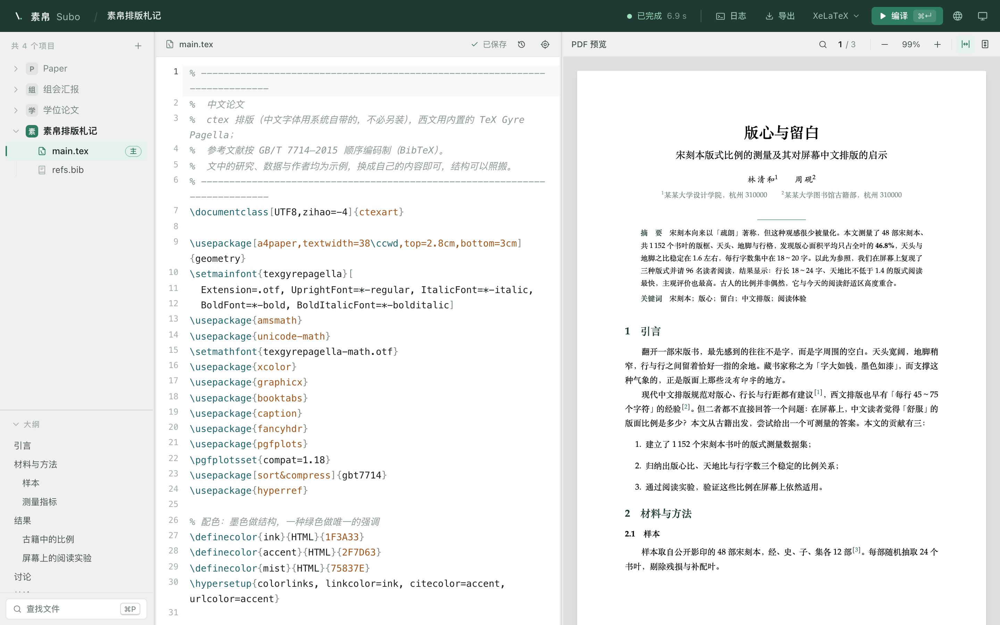
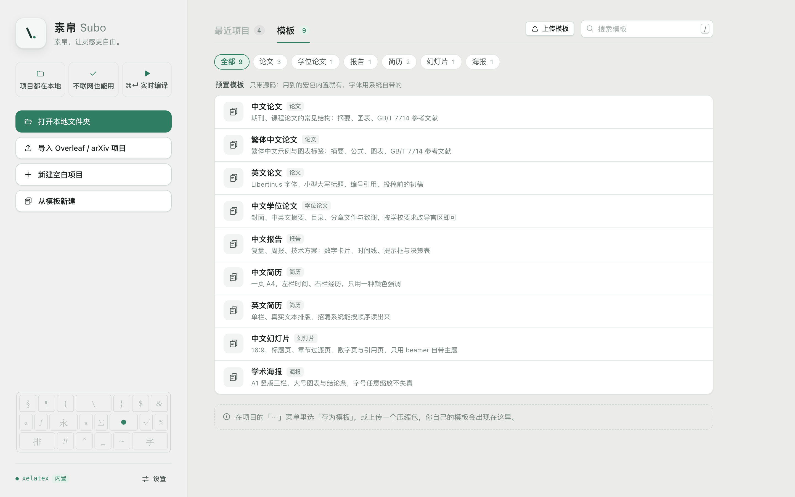
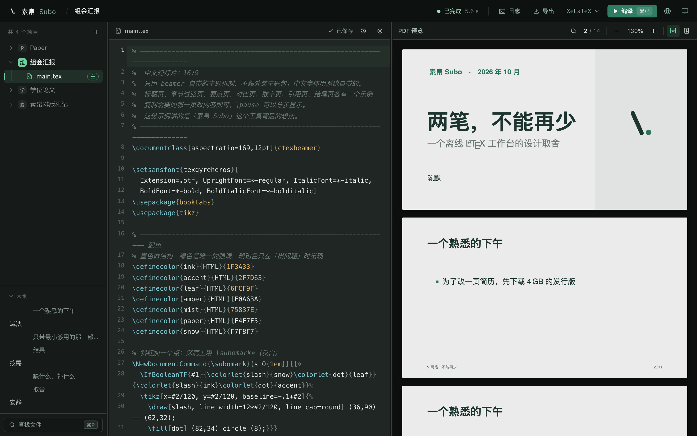

<div align="center">

<picture>  
  <source media="(prefers-color-scheme: dark)" srcset="docs/brand/subo-mark-inverse.svg">  
    
</picture>

# 素帛 Subo

**开箱即用的 LaTeX 编辑器。**

装上就能写、能编、能看。文稿留在你自己的电脑上，已有依赖的项目可以离线编译。

[官网与下载](https://cn.subo.ink/zh-cn/) · [为什么是素帛](#为什么是素帛) · [能做什么](#能做什么) · [安装](#安装) · [参与开发](#参与开发) · [文档](#文档)

简体中文 · [English](README.en.md)

</div>

  


<picture>  
  <source media="(prefers-color-scheme: dark)" srcset="docs/images/article-dark.png">  
    
</picture>

<p align="center"><sub>内置模板「中文论文」：左边文件和大纲，中间源码，右边实时 PDF。</sub></p>

## 为什么是素帛

写 LaTeX 的人，大多在两条路之间来回：

- **在线编辑器**：打开就能用，可文稿放在别人的服务器上。截稿前编译排队、超时、  
  免费额度不够；网一断，什么都做不了；没发表的论文、内部报告，也不总是适合上传。
- **本地发行版**：数据在自己手里，可门槛是一下午。先下几个 GB 的完整发行版，再挑编辑器、  
  配 PDF 阅读器、调正反向跳转、找中文字体。为了改一页简历，先装半天环境。

真正写起来还有一道坎：报错只说 `File 'xxx.sty' not found`，不说该装哪个包、去哪装、  
装完会不会把环境弄乱。

**素帛想把这两条路合成一条**：像在线编辑器一样打开就写，像本地环境一样完全属于你。

|            |                                              |
| ---------- | -------------------------------------------- |
| **装上就能编**  | 安装包自带精简 TeX Live，中文开箱可用，不需要另装 TeX。           |
| **缺什么取什么** | 缺少宏包时可联网按需安装；离线时记录缺失项，联网后补齐。 |
| **文件就是文件** | 项目是磁盘上的普通文件夹，可以用 git 管、用别的编辑器改，素帛自动感知。       |
| **本地优先** | 没有账号和云端项目；编译所需的引擎与宏包已在本机时，可以断网使用。 |

安装缺失宏包需要访问配置的下载源；可选 AI 功能会将请求发送到你配置的服务。
桌面版默认自动检查更新，可在设置中关闭；自动下载默认关闭。

## 能做什么

**写**

- LaTeX 命令与环境补全，`\begin{fig` 直接出整段骨架；`\ref` / `\cite` 收全项目的标签和 `.bib`
- 文档大纲顺着 `\input` / `\include` 列出全部章节，点一下跳过去
- 查找替换、注释、一键格式化、按文件名快速打开，常用操作都有快捷键

**编**

- ⌘↵ 编译，状态实时推送；XeLaTeX、pdfLaTeX 内置，LuaLaTeX、pTeX 等按需安装，按项目自动选择
- 问题面板把日志里的错误、警告、行过宽整理成列表，点一下跳到源码对应行
- 编译有超时和内存上限，跑飞的文档不会拖垮整台机器

**看**

- PDF 只渲染视口附近的页，几百页的论文也秒开；重新编译不闪白、不丢阅读位置
- SyncTeX 双向跳转：从源码定位到 PDF，或在 PDF 上双击回到源码
- 浅色、深色、跟随系统；界面支持简体中文、繁體中文、English、日本語和 한국어

**安心**

- 本地历史：每隔几分钟自动留一份，随时比对差异、一键恢复，不写进项目目录
- 别的程序改了正在编辑的文件，自动载入；两边都有改动时让你挑，另一份进历史
- **字盘快照**：把项目实际用到的补装宏包打成一个文件，带到离线机器上导入就能编

**起步**

- 内置模板：多语言论文、学位论文、报告、简历、幻灯片、学术海报
- 导入在线编辑器导出的 zip、GitHub 仓库压缩包、arXiv 源码包；也能直接打开本地已有的文件夹，原地编辑

**可选：AI 辅助**

- ⌘K 改写选中的段落，报错旁一键「修复」，结果都以内联 diff 呈现，Tab 接受、Esc 拒绝
- 用你自己的 API Key，兼容 OpenAI 协议，也可以接本地模型；不配置就不出现，关掉它功能不减

<table>  
  <tr>  
    <td width="50%"></td>  
    <td width="50%"></td>  
  </tr>  
  <tr>  
    <td align="center"><sub>内置模板，按用途分好类</sub></td>  
    <td align="center"><sub>深色外观 · 内置模板「中文幻灯片」</sub></td>  
  </tr>  
</table>

## 安装

素帛还在早期预览阶段。

| 平台 | 获取方式 |
| --- | --- |
| **macOS**（Apple 芯片 / Intel） | 从 [官网](https://cn.subo.ink/zh-cn/) 下载 dmg，安装包约 195 MB，自带精简 TeX Live |
| **Linux**（deb / AppImage） | 从源码构建，见 [参与开发](#参与开发)；系统库可参考 [CI 配置](.github/workflows/desktop.yml) |
| **Windows** | 仍在开发和验证中，暂不提供安装包 |

应用会自动检查更新（可在设置中关闭）。

装好之后，命令行同样可用：`subo build <目录> --install` 编译并自动补装缺的宏包，详见 [命令行文档](docs/cli.md)。

## 参与开发

素帛是一个本地服务加一个网页前端，桌面版用 Tauri 把两者装进同一个进程：

```
┌─────────────── 桌面壳 · Tauri v2 ───────────────┐
│  前端 · React + CodeMirror 6 + PDF.js            │
│        │  HTTP + SSE（127.0.0.1，随机端口）       │
│  本地服务 · Rust / axum                          │
│        ├─ 项目与文件   ├─ 编译调度   ├─ SyncTeX   │
│        └─ 宏包按需安装 ──→ 内置精简 TeX Live      │
└─────────────────────────────────────────────────┘
```

**环境**：Node.js 20（CI 使用的版本）、Rust stable，以及用于实际编译文档的 TeX Live。
桌面版还需要 Tauri 的平台依赖；Linux 所需系统库可参考 [CI 配置](.github/workflows/desktop.yml)。
首次运行先安装依赖：

```bash
(cd app && npm ci)
(cd desktop && npm ci) # 仅桌面版需要
```

下面的命令从项目根目录运行：

```bash
./scripts/dev.sh                 # 构建前端并启动本地服务，打开 http://127.0.0.1:8787
```

```bash
./scripts/desktop.sh             # 桌面版调试窗口
```

```bash
./scripts/desktop.sh bundle      # 打当前平台的安装包
```

打包前用 `./scripts/texlive-trim.sh <TeX Live 根目录>` 生成要内置的精简 TeX Live；  
Linux 需要的系统库见 [CI 配置](.github/workflows/desktop.yml)。

<details>

<summary>手动构建与运行参数</summary>

```bash
(cd app && npm run build)
(cd server && cargo build)
./server/target/debug/subo-server --port 8787 --dist app/dist
```

- 项目库默认在 `~/Documents/Subo/`，`--home` 可改；「打开文件夹」登记的目录原地编辑，编译产物不写进去
- `--engine auto|xelatex|tectonic|mock`：`auto` 依次探测，都没有时用 `mock` 生成占位 PDF，方便只开发界面
- 工具链装在自包含工作区时，用 `SUBO_WS=<路径>` 指给 `scripts/dev.sh`

</details>

<details>

<summary>目录结构</summary>

```
subo/
├── app/        前端：React + CodeMirror 6 + PDF.js
├── server/     本地服务与命令行：axum，项目 / 文件 / 编译 / 事件
├── desktop/    桌面壳：Tauri v2，进程内起服务
├── scripts/    开发、打包、TeX Live 裁剪
├── docs/       架构、品牌素材
└── fixtures/   测试用项目
```

</details>

<details>

<summary>名字里的印刷车间</summary>

产品名取自工艺，模块名取自印刷车间。功能会变，名字不该跟着变。

| 名字          | 含义             | 对应        |
| ----------- | -------------- | --------- |
| **素帛 Subo** | 未染的白绢，纸以前落笔的底子 | 产品        |
| **quire**   | 一叠纸，书的最小装订单位   | 项目        |
| **case**    | 活字字盘           | 宏包按需安装与缓存 |
| **press**   | 印刷机            | 编译调度      |
| **proof**   | 校样             | PDF 预览    |

</details>

想提交改动，先看 [参与贡献](CONTRIBUTING.md)。**几条约定**：界面上不写死任何自然语言文案，一律走 `t("分组.键")`，新增文案须同步补齐所有内置语言  
（[多语言规范](docs/i18n.md)）；改完前端至少跑一遍 `cd app && npx tsc --noEmit && npm run check:i18n`。
服务端测试可运行 `cd server && cargo test`；涉及打包和内置 TeX Live 时，另见
[冒烟测试说明](fixtures/smoke/README.md)。

### 接下来

Windows 版完善 · 安装包签名与公证 · 拼写检查 · 字数统计 · 项目删除

不在计划里的：多人实时协作、账号与云端项目。素帛只做好一件事：在你自己的电脑上写 LaTeX。

## 文档

- [架构](docs/architecture.md)：定位、进程模型、按需取包
- [命令行与本地接口](docs/cli.md)
- [界面多语言规范](docs/i18n.md)
- [参与贡献](CONTRIBUTING.md) · [安全问题报告](SECURITY.md)

## 许可证

项目代码按 [Apache License 2.0](LICENSE) 发布。第三方依赖及安装包内的 TeX Live 组件各有许可证；
前端依赖许可清单在构建时生成，TeX Live 的许可文件随其发行版提供。

  


<p align="center"><sub>素帛，让灵感更自由。</sub></p>
